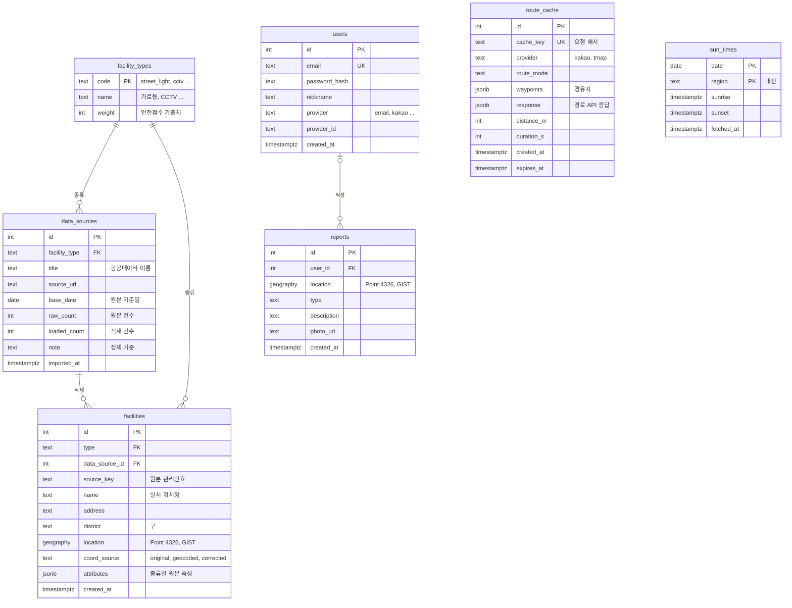

# 등대 — ERD

작성일: 2026-10-03 · 갱신: 2026-10-21 (보안등·지구대 임시 가중치) · 상태: 초안 v0.1 (팀 리뷰 후 6~7주차 발표 전 확정)
기준: [REQUIREMENTS](REQUIREMENTS.md), [API 명세](API.md), [데이터 검증 결과](../data/validation/README.md)

DB는 PostgreSQL + PostGIS (Supabase), 스키마 관리는 Prisma 마이그레이션.

## 한눈에 보기



| 구분 | 테이블 | 요구사항 | 쓰는 API |
|---|---|---|---|
| Must | `facility_types` | FR-006 | `POST /routes/search` |
| Must | `data_sources` | (적재 이력) | — |
| Must | `facilities` | FR-002·006 | `GET /facilities`, `POST /routes/search` |
| Must | `route_cache` | FR-004·006·007 | `POST /routes/search` |
| Must | `sun_times` | FR-005 | `GET /daylight` |
| Could | `users` | FR-011 | `/auth/*` |
| Could | `reports` | FR-009·010 | `/reports`, `POST /routes/search` (점수 감점) |

`GET /places`는 카카오 로컬 API 결과를 그대로 돌려주므로 테이블이 없다.

## 테이블

공통: 테이블·컬럼 이름은 snake_case (Prisma 모델은 PascalCase + `@@map`/`@map`). ID는 `integer` — Prisma의 `BigInt`는 JS `BigInt`라 그대로 JSON 응답에 못 넣는다. 시각은 `timestamptz`.

### `facility_types` — 시설 종류와 안전점수 가중치

가중치를 코드가 아니라 테이블에 둔다. REQUIREMENTS의 점수 규칙이 "숫자는 전부 초안"이라 실제 경로를 보며 조정할 때 배포 없이 바꿀 수 있다.

| 컬럼 | 타입 | 제약 | 설명 |
|---|---|---|---|
| `code` | text | PK | 아래 값. `/api/facilities` 응답의 `type`과 같다 (응답에는 지도에 표시하는 `cctv`·`emergency_bell`·`police`만, FR-002) |
| `name` | text | NOT NULL | 화면 표시 이름 |
| `weight` | integer | NOT NULL | 안전점수 가중치 (개·대당) |

| code | name | weight (REQUIREMENTS 초안) |
|---|---|---|
| `street_light` | 가로등 | 1 |
| `security_light` | 보안등 | 1 (**임시**, 가로등과 같게) |
| `cctv` | CCTV | 3 |
| `emergency_bell` | 안심벨(비상벨) | 5 |
| `police` | 지구대·파출소 | 10 (**임시**, 사람이 상주해 안심벨보다 높게) |

보안등·지구대는 REQUIREMENTS 점수 표에 없어서 9주차 MVP용 임시값을 넣었다 (2026-10-21 상협). 지구대는 처음 5(안심벨과 같게)로 잡았다가 승민 제안으로 10 (PR #21). 시설 데이터 적재 후 실제 후보 경로 점수를 보고 확정한다.

제보 감점(−5/건, 최근 30일)은 시설이 아니라 `reports`에서 계산한다.

24시 시설(편의점·심야 약국, 초안의 `store_24h`)은 2026-10-10 제외했다 (REQUIREMENTS FR-002 참고). 나중에 다시 넣게 되면 이 표에 행 하나만 추가하면 된다.

### `data_sources` — 원본 데이터 출처·적재 이력

적재할 때마다 한 행. `data/README.md`의 "원본 건수·적재 건수 기록" 규칙을 DB에도 남긴다. 다시 적재하면 새 행이 생기고, 이전 행은 이력으로 남는다.

| 컬럼 | 타입 | 제약 | 설명 |
|---|---|---|---|
| `id` | integer | PK | |
| `facility_type` | text | FK → `facility_types.code` | |
| `title` | text | NOT NULL | 예: 대전광역시 방범용 CCTV |
| `source_url` | text | | 공공데이터포털 주소 |
| `base_date` | date | | 원본 기준일 (CCTV는 기준일 필드가 없어 null) |
| `raw_count` | integer | NOT NULL | 원본 건수 (totalCount) |
| `loaded_count` | integer | NOT NULL | 정제 후 적재 건수 |
| `note` | text | | 적용한 정제 기준 요약 (예: "대전 밖 좌표 1행 제외") |
| `imported_at` | timestamptz | NOT NULL, 기본 now() | |

### `facilities` — 안전시설 (가로등·보안등·CCTV·비상벨·지구대)

종류 5개를 한 테이블에 둔다. 안전점수는 "구간 반경 30m 안의 시설을 종류별로 세기"라 테이블 하나·공간 인덱스 하나로 한 번에 조회한다. 약 7만 5천 행.

| 컬럼 | 타입 | 제약 | 설명 |
|---|---|---|---|
| `id` | integer | PK | |
| `type` | text | FK → `facility_types.code`, NOT NULL | |
| `data_source_id` | integer | FK → `data_sources.id`, NOT NULL | 어느 적재분인지 |
| `source_key` | text | | 원본 식별값: 비상벨 `MNG_NO`, CCTV `manageNo`, 가로등 `관리번호`, 지구대·파출소 `관서명`(원본 `연번`은 전국 목록 순번이라 경찰청이 목록을 갱신하면 바뀔 수 있어서, PR #13). 보안등은 고유 ID가 없어 null. CCTV `manageNo`도 중복이 있어 UNIQUE를 걸지 않는다 |
| `name` | text | | 설치 위치명 (비상벨 `INSTL_PSTN`, 보안등 `LMP_LC_NM` 등) |
| `address` | text | | 도로명 우선, 없으면 지번 |
| `district` | text | CHECK (5개 구) | 동구·중구·서구·유성구·대덕구 |
| `location` | geography(Point, 4326) | NOT NULL, GIST 인덱스 | 위치 |
| `coord_source` | text | NOT NULL, 기본 `original` | `original` 원본 좌표 / `geocoded` 주소로 다시 구한 좌표 / `corrected` 규칙으로 고친 좌표 |
| `attributes` | jsonb | 기본 `{}` | 종류별 원본 속성 (아래) |
| `created_at` | timestamptz | 기본 now() | |

인덱스: `location` GIST, `type` B-tree.

`attributes`에 넣는 것 (원본 컬럼 → 키, 정제 기준이 정해지기 전이라 원본 값을 남긴다)

| 종류 | 키 | 쓰임 |
|---|---|---|
| 비상벨 | `place_type`(`INSTL_PLC_TYPE`, 화장실 62%), `last_check`(`LAST_CHCK_RSLT_SE`), `installed_year`, `police_link`(`POLC_LINK_EN`) | 화장실·점검 불량 포함 여부를 조회 때 거를 수 있음 |
| CCTV | `cctv_type`(`cctvTy`), `manager`(`mgcNm`) | |
| 보안등 | `lamp_count`(`INSTALLATION_CO`), `install_type`(`INSTALLATION_TYPE`) | |
| 가로등 | `fixture_count`(`등기구수량`) | 98%가 0이라 지금은 점수에 못 씀 |
| 지구대·파출소 | `kind`(지구대/파출소), `police_station` | |

정제 기준 미결정 항목을 이 구조로 열어 둔다 (ROADMAP "정제 때 정할 것")

- CCTV 같은 좌표 여러 대(461곳): 원본 행을 그대로 한 행씩 넣으면 대수로 셀지(`count(*)`), 지점으로 셀지(`count(DISTINCT location)`)를 조회에서 고를 수 있다
- 화장실 비상벨·점검 불량 비상벨: `attributes`로 조회 때 거르거나, 적재 때 빼고 `data_sources.note`에 기록
- 4자리 비상벨·서구 CCTV 경도 밀림·대전 밖 좌표: 고치면 `coord_source`에 `geocoded`·`corrected`로 남겨 원본과 구분

### `route_cache` — 경로 API 응답 캐시

카카오 도보 경로는 일 1,000건 무료이고 B안이면 검색 1회에 3번 호출한다. 같은 요청은 다시 부르지 않게 경로 API 응답을 저장한다. 서버 배포처(Vercel 서버리스/일반 서버)가 정해지지 않아 메모리 대신 DB에 둔다 — 어느 쪽이든 동작한다.

| 컬럼 | 타입 | 제약 | 설명 |
|---|---|---|---|
| `id` | integer | PK | |
| `cache_key` | text | UNIQUE | `provider`·`route_mode`·출발·도착·경유지를 정규화한 문자열의 SHA-256. 좌표는 소수점 4자리(약 10m)로 반올림 (초안) |
| `provider` | text | NOT NULL | `kakao` (티맵 교체 대비) |
| `route_mode` | text | NOT NULL | 카카오 `BROAD_FIRST`/`SHORTEST`/`ACCESSIBLE` (티맵이면 `searchOption`) |
| `waypoints` | jsonb | 기본 `[]` | 경유지 `{lat, lng}` 목록 — A안(경유지 우회) 대비 |
| `response` | jsonb | NOT NULL | 경로 API 원본 응답 (`path.points` 포함) |
| `distance_m` | integer | | |
| `duration_s` | integer | | |
| `created_at` | timestamptz | 기본 now() | |
| `expires_at` | timestamptz | NOT NULL | 만료 시각 (초안 24시간) |

- 안전점수·구간 색상은 저장하지 않고 요청마다 계산한다. 시설 데이터와 가중치가 바뀌면 저장해 둔 점수가 틀려지기 때문
- 출발·도착은 집 주소일 수 있는 위치정보다. 키는 해시로만 두고 사용자와 연결하지 않으며, 만료된 행은 지운다 (NFR-004)
- 구현 (2026-10-25, `apps/api/src/walk/`): 반올림한 좌표를 카카오 호출에도 그대로 써서 저장한 응답과 키가 늘 맞는다. `status`가 `OK`인 응답만 저장하고(경로를 못 찾은 응답은 저장하지 않음), 새 응답을 저장할 때 만료된 행을 같이 지운다. DB가 없거나 안 되면 캐시 없이 카카오를 부른다

### `sun_times` — 일출·일몰 캐시 (FR-005)

한국천문연구원 출몰시각 API를 서버에서 하루 1회 부르고 저장한다. 날짜별 계산값이라 1년치를 미리 넣어 둘 수도 있다 (노션 3.2).

| 컬럼 | 타입 | 제약 | 설명 |
|---|---|---|---|
| `date` | date | PK | |
| `region` | text | PK, 기본 `대전` | 지역명. 천문연 API 요청 파라미터 `location`에 넣는 값 (다른 테이블의 `location`은 좌표라 이름을 나눔). 지금은 대전 한 지점(시청 부근) |
| `sunrise` | timestamptz | NOT NULL | |
| `sunset` | timestamptz | NOT NULL | 야간 판별 기준 |
| `fetched_at` | timestamptz | 기본 now() | |

API 응답의 시각 값은 끝에 공백이 있고 `HHMM`·`HHMMSS`가 섞여 있어 저장 전에 정리한다. 쓰는 값인 `sunrise`·`sunset`은 `"0646  "`(HHMM + 공백)이고, `HHMMSS`는 남중 시각(`suntransit`) 등 쓰지 않는 값이다 (2026-10-25 확인). 서버는 그 날 한국 시각(`timestamptz`)으로 바꿔 넣는다. 한 번 넣은 행은 지우지 않는다 (날짜별 계산값이라 개인정보가 없음).

### `users` — 회원 (Could, FR-011)

| 컬럼 | 타입 | 제약 | 설명 |
|---|---|---|---|
| `id` | integer | PK | API `User.id` |
| `email` | text | UNIQUE, NOT NULL | |
| `password_hash` | text | | bcrypt. 소셜 로그인 사용자는 null |
| `nickname` | text | NOT NULL | |
| `provider` | text | NOT NULL, 기본 `email` | 소셜 로그인 대비 |
| `provider_id` | text | (`provider`, `provider_id`) UNIQUE | 소셜 계정 ID |
| `created_at` | timestamptz | 기본 now() | |

### `reports` — 위험 제보 (Could, FR-009·010)

| 컬럼 | 타입 | 제약 | 설명 |
|---|---|---|---|
| `id` | integer | PK | API `Report.id` |
| `user_id` | integer | FK → `users.id`, NULL 허용 | 제보에 로그인이 필요한지 미합의라 null 허용 |
| `location` | geography(Point, 4326) | NOT NULL, GIST 인덱스 | 제보 위치 |
| `type` | text | NOT NULL | `dark` 조명 부족 / `no_cctv` CCTV 없음 / `suspicious` 우범지역 / `others` 기타 (`shared/types.ts`의 `ReportType`, 화면 S4 유형과 같음) |
| `description` | text | | |
| `photo_url` | text | | 사진 첨부 여부 미정. 사진은 클라우드 스토리지에 두고 URL만 저장 (사진 자체 저장은 Won't) |
| `created_at` | timestamptz | 기본 now() | 최근 30일 감점 계산에 쓴다 |

## 안전점수 계산에서 테이블을 쓰는 방식

경로를 약 50m 구간으로 나누고, 구간마다 반경 30m 안의 시설을 종류별로 센 뒤 `facility_types.weight`를 곱한다 (REQUIREMENTS 안전점수 규칙).

```sql
-- 구간 하나 주변 30m 안의 시설을 종류별로 세서 가중치를 곱한다
SELECT f.type, count(*) AS n, count(*) * t.weight AS score
FROM facilities f
JOIN facility_types t ON t.code = f.type
WHERE ST_DWithin(f.location, ST_GeogFromText($1), 30)   -- $1: 'LINESTRING(경도 위도, ...)'
GROUP BY f.type, t.weight;
```

- 위치를 `geometry`가 아니라 `geography`로 둔 이유: 거리 단위가 m라 `ST_DWithin(..., 30)`을 그대로 쓸 수 있고, `location` 컬럼의 GIST 인덱스가 그대로 쓰인다 (`geometry`에 `::geography`를 붙여 비교하면 인덱스를 못 탄다)
- 경로 하나의 구간을 모두 한 쿼리로 묶어 보내면 NFR-001(3초)에 맞추기 쉽다. 실제 속도는 적재 후 측정

## 미결정 사항과의 관계

| 미결정 | 이 ERD에서 |
|---|---|
| 안심경로 계산 방식 — B 기본 + A 보강으로 확정 (2026-10-18) | 이 ERD 그대로 쓴다 (A 보강의 경유지는 `route_cache.waypoints`). MVP 뒤 **C안(자체 엔진)을 시도하면** OSM 보행자 도로망 테이블(노드·링크, 링크별 안전점수)을 추가해야 해서 지금은 그리지 않았다 |
| 서버 배포처 | 영향 없음 (캐시를 DB에 둠) |
| 정제 기준 | `attributes`·`coord_source`로 어느 쪽으로 정해도 담을 수 있게 둠 |
| 보안등·지구대 가중치 | 임시값(보안등 1·지구대 10)으로 넣고, 정해지면 `facility_types.weight` 값만 바꾼다 |
| 제보 로그인 필요 여부, 사진 첨부 | `reports.user_id`·`photo_url`을 null 허용으로 둠 |

## Prisma·PostGIS 메모

- Supabase에서 PostGIS 확장을 켠다 (Database → Extensions → `postgis`)
- 위치 컬럼은 Prisma 스키마에 `Unsupported("geography(Point, 4326)")`로 선언한다. Prisma Client의 일반 쿼리로는 읽고 쓰지 못해 `$queryRaw`·`$executeRaw`로 다룬다 (Prisma 공식 문서: 확장 타입은 `Unsupported` + raw SQL)
- 공간 인덱스는 Prisma 스키마(`@@index([location], type: Gist)`)로 만들고, `district` CHECK처럼 스키마로 못 쓰는 것은 마이그레이션 SQL에 직접 추가한다. 공용 DB라 `prisma migrate dev`(DB 초기화를 물음) 대신 `migrate diff`로 SQL을 뽑아 `migrate deploy`한다 — 방법은 `apps/api/README.md` "마이그레이션" (2026-10-21 첫 마이그레이션)
- Prisma Studio는 확장 타입이 있는 테이블을 읽지 못한다 → 데이터 확인은 DBeaver·QGIS
- 시설 데이터 적재(Python, 근영)는 Prisma를 거치지 않고 DB에 직접 넣는다. **스키마는 Prisma 마이그레이션 한 곳에서만 바꾼다** — Python 쪽에서 테이블을 만들거나 고치지 않는다

## 확인할 것

- [ ] 보안등·지구대 가중치 (REQUIREMENTS 점수 표에 없음) — MVP용 임시값 보안등 1·지구대 10 (2026-10-21 상협, 지구대는 승민 제안으로 5 → 10, PR #21). 적재 후 후보 경로 점수를 보고 확정
- [ ] `route_cache` 좌표 반올림 자릿수(초안 4자리)·만료 시간(초안 24시간)
- [x] 제보 유형: 화면 S4(조명 부족·CCTV 없음·우범지역)에 맞춰 `dark`/`no_cctv`/`suspicious`/`others`로 통일 (2026-10-10 승민 리뷰, 기타는 승민 의견대로 `others`. `shared/types.ts`·API 명세 함께 수정)
- [x] 24시 시설 범위: 편의점·심야 약국 모두 제외하고 `store_24h` 행 삭제 (2026-10-10 승민 제안·상협 동의, PR #6)
